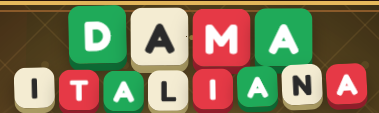

  <!-- BANNER INIZIALE (CONTIENE GIÀ IL TITOLO GRAFICO O LOGO) -->
  

    

  

    
    
    
    
  

 

  <h2 style="color: #ffd166; text-transform: uppercase; margin-top: 0;">🌐 ABOUT THIS GAME / INFORMAZIONI SUL GIOCO</h2>
  
<b>[EN]:</b> Dama Italiana is a modern web implementation of traditional Italian Checkers. Featuring multiple game modes (Classic, Ranked, Speedrun, and Multi-Jump Puzzles), adjustable bot intelligence using minimax alpha-beta pruning, dynamic themes, SVG pieces, and an immersive Web Audio API soundtrack.

  
<b>[IT]:</b> Dama Italiana è una moderna implementazione web del tradizionale gioco della dama italiana. Include diverse modalità di gioco (Classica, Classificata, Speedrun e Puzzle di Salto Multiplo), intelligenza artificiale con potatura alfa-beta, temi dinamici, pedine in SVG e una colonna sonora immersiva sintetizzata con Web Audio API.

 

  <h3 style="text-transform: uppercase; margin-top: 0; color: #9e0f22;">⚡ CORE HIGHLIGHTS / CARATTERISTICHE PRINCIPALI</h3>
  <ul>
    <li><b>Author / Autore:</b> Giuseppe Caldarola (<i>Seneo</i>).</li>
    <li><b>Game Engine:</b> Full 64-square rule management supporting Italian checkers rules, optional captures, king promotions, and legal move generators.</li>
    <li><b>AI Opponents:</b> Smart bots ranging from Waiter (easy) to Master (hard) leveraging minimax algorithms.</li>
    <li><b>Audio Engine:</b> Native Web Audio API synthesizer for chiptune background loops and responsive game sound effects.</li>
    <li><b>Immersive Environments:</b> Dynamic HTML5 canvas backgrounds reflecting iconic Italian locations (Rome, Venice, Naples, Bari) and 3D perspectives.</li>
  </ul>

 

  <h3 style="text-transform: uppercase; margin-top: 0; color: #ff6f5e;">🔒 LICENSE / LICENZA</h3>
  
<b>[EN]:</b> © Giuseppe Caldarola (Seneoo). All rights reserved. This is a proprietary project. Copying, modifying, distributing, or using this code and its assets in any way, shape, or form is strictly prohibited without explicit written permission.

  
<b>[IT]:</b> © Giuseppe Caldarola (Seneoo). Tutti i diritti riservati. Questo è un progetto proprietario. È severamente vietato copiare, modificare, distribuire o utilizzare questo codice e le relative risorse in qualsiasi modo o forma senza previa autorizzazione scritta.

 

  
<b>🔗 LINKS & CONTACTS</b>

  
  
  

 
